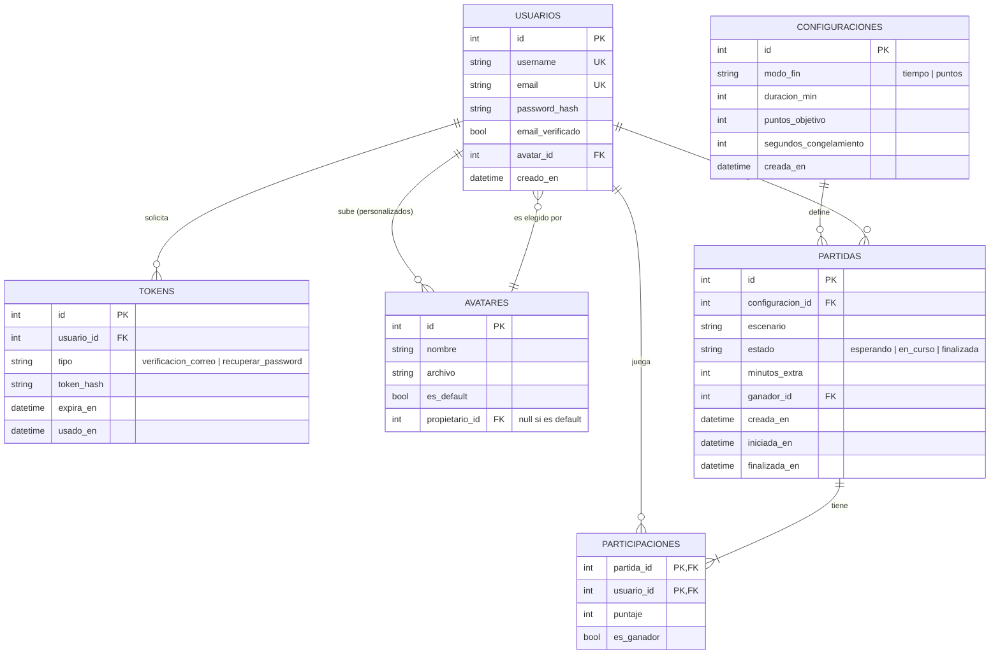

# Modelo de datos — Battle Arena Challenge

Borrador para el Sprint 2. Base de datos relacional (PostgreSQL). Cubre jugadores, partidas y récords, como pide el enunciado.

## Diagrama entidad-relación



## Decisiones de diseño

| Decisión | Motivo |
|----------|--------|
| `username` y `email` con restricción `UNIQUE` | US-01 (CA-01.2 y CA-01.3): la base de datos garantiza la unicidad aunque el código falle. El correo se compara en minúsculas. |
| Contraseña como `password_hash` (bcrypt o argon2) | Nunca se guarda la contraseña en claro. |
| Una sola tabla `TOKENS` con campo `tipo` | Sirve para la verificación de correo (US-02) y la recuperación de contraseña (US-05), ambos con vencimiento (`expira_en`) y uso único (`usado_en`). Se guarda el hash del token, no el token. |
| `AVATARES` con `propietario_id` opcional | Los 5 avatares por defecto no tienen propietario; los subidos desde disco sí. `USUARIOS.avatar_id` apunta al elegido, así se conserva con la sesión cerrada (CA-06.4). |
| `CONFIGURACIONES` separada de `PARTIDAS` | La ventana de configuración (US-08) recupera la última configuración usada y cada partida conserva la suya. |
| `minutos_extra` en `PARTIDAS` | El desempate de la US-16 suma 2 minutos y mantiene el puntaje. |
| `PARTICIPACIONES` con clave compuesta | Relación muchos a muchos entre jugadores y partidas, con el puntaje de cada uno. |
| Récords como **consulta o vista**, no como tabla | Partidas jugadas, victorias y puntaje máximo salen de `PARTICIPACIONES`. Así no se duplican datos ni se desincronizan. |
| Escenario como texto (`escenario`) | Identifica un archivo de mapa del cliente/servidor; no hace falta tabla para el Sprint 2. |

## Qué se guarda en la base y qué en memoria

- **Persistente:** cuentas, avatares, tokens, configuraciones, partidas y puntajes finales. El enunciado no acepta guardar esto solo en memoria.
- **En memoria del servidor (mientras dura la partida):** posición actual de cada avatar, conexiones WebSocket y el temporizador. Cambian muchas veces por segundo y no tiene sentido escribirlas en la base. Al finalizar la partida se guardan los puntajes y el ganador.

## Reglas de integridad

- `USUARIOS.email_verificado` debe ser verdadero para poder iniciar una partida (CA-02.5).
- Una partida necesita al menos 2 filas en `PARTICIPACIONES` para pasar de `esperando` a `en_curso` (CA-09.2).
- Si `modo_fin = 'tiempo'`, `duracion_min` es obligatorio; si es `'puntos'`, lo es `puntos_objetivo`.
- `PARTIDAS.ganador_id` es nulo hasta que la partida finaliza.

## Script SQL inicial (PostgreSQL)

```sql
CREATE TABLE avatares (
    id SERIAL PRIMARY KEY,
    nombre VARCHAR(50) NOT NULL,
    archivo VARCHAR(255) NOT NULL,
    es_default BOOLEAN NOT NULL DEFAULT FALSE,
    propietario_id INTEGER  -- FK a usuarios, se agrega abajo
);

CREATE TABLE usuarios (
    id SERIAL PRIMARY KEY,
    username VARCHAR(30) NOT NULL UNIQUE,
    email VARCHAR(255) NOT NULL,
    password_hash VARCHAR(255) NOT NULL,
    email_verificado BOOLEAN NOT NULL DEFAULT FALSE,
    avatar_id INTEGER REFERENCES avatares(id),
    creado_en TIMESTAMPTZ NOT NULL DEFAULT now()
);
CREATE UNIQUE INDEX usuarios_email_unico ON usuarios (lower(email));

ALTER TABLE avatares
    ADD CONSTRAINT fk_avatar_propietario
    FOREIGN KEY (propietario_id) REFERENCES usuarios(id);

CREATE TABLE tokens (
    id SERIAL PRIMARY KEY,
    usuario_id INTEGER NOT NULL REFERENCES usuarios(id) ON DELETE CASCADE,
    tipo VARCHAR(30) NOT NULL
        CHECK (tipo IN ('verificacion_correo', 'recuperar_password')),
    token_hash VARCHAR(255) NOT NULL,
    expira_en TIMESTAMPTZ NOT NULL,
    usado_en TIMESTAMPTZ
);

CREATE TABLE configuraciones (
    id SERIAL PRIMARY KEY,
    modo_fin VARCHAR(10) NOT NULL CHECK (modo_fin IN ('tiempo', 'puntos')),
    duracion_min INTEGER CHECK (duracion_min > 0),
    puntos_objetivo INTEGER CHECK (puntos_objetivo > 0),
    segundos_congelamiento INTEGER NOT NULL DEFAULT 5
        CHECK (segundos_congelamiento >= 0),
    creada_en TIMESTAMPTZ NOT NULL DEFAULT now(),
    CHECK (
        (modo_fin = 'tiempo' AND duracion_min IS NOT NULL) OR
        (modo_fin = 'puntos' AND puntos_objetivo IS NOT NULL)
    )
);

CREATE TABLE partidas (
    id SERIAL PRIMARY KEY,
    configuracion_id INTEGER NOT NULL REFERENCES configuraciones(id),
    escenario VARCHAR(50) NOT NULL,
    estado VARCHAR(15) NOT NULL DEFAULT 'esperando'
        CHECK (estado IN ('esperando', 'en_curso', 'finalizada')),
    minutos_extra INTEGER NOT NULL DEFAULT 0,
    ganador_id INTEGER REFERENCES usuarios(id),
    creada_en TIMESTAMPTZ NOT NULL DEFAULT now(),
    iniciada_en TIMESTAMPTZ,
    finalizada_en TIMESTAMPTZ
);

CREATE TABLE participaciones (
    partida_id INTEGER NOT NULL REFERENCES partidas(id) ON DELETE CASCADE,
    usuario_id INTEGER NOT NULL REFERENCES usuarios(id),
    puntaje INTEGER NOT NULL DEFAULT 0,
    es_ganador BOOLEAN NOT NULL DEFAULT FALSE,
    PRIMARY KEY (partida_id, usuario_id)
);

-- Récords e historial de un jugador (vista)
CREATE VIEW estadisticas_jugador AS
SELECT
    u.id AS usuario_id,
    u.username,
    COUNT(p.partida_id) AS partidas_jugadas,
    COUNT(*) FILTER (WHERE p.es_ganador) AS victorias,
    COALESCE(MAX(p.puntaje), 0) AS puntaje_maximo
FROM usuarios u
LEFT JOIN participaciones p ON p.usuario_id = u.id
GROUP BY u.id, u.username;
```

> Los 5 avatares por defecto se insertan al iniciar la base (datos semilla), con `es_default = TRUE` y sin propietario.