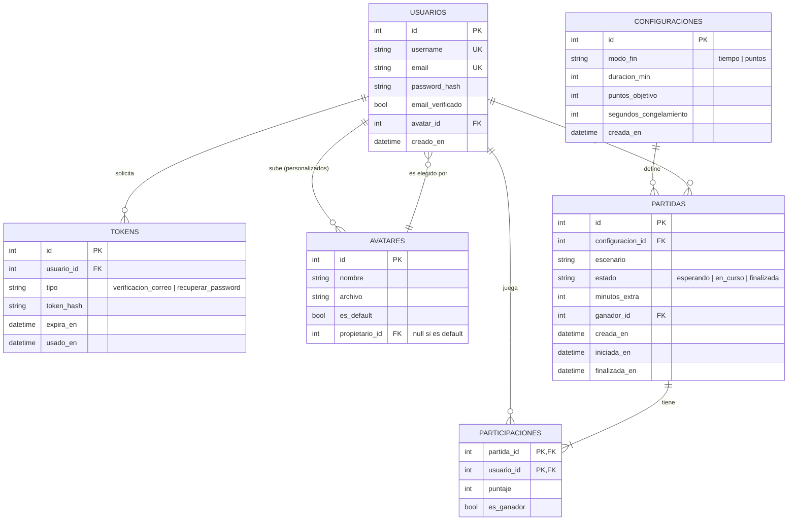

# Modelo de datos — Battle Arena Challenge

Borrador para el Sprint 2. Cubre jugadores, partidas y récords, como pide el enunciado.

## Diagrama entidad-relación

## Decisiones de diseño

| Decisión | Motivo |
|----------|--------|
| `username` y `email` con restricción `UNIQUE` | US-01 (CA-01.2 y CA-01.3): la base de datos garantiza la unicidad aunque el código falle. El correo se compara en minúsculas. |
| Contraseña como `password_hash` (bcrypt o argon2) | Nunca se guarda la contraseña en claro. |
| Una sola tabla `TOKENS` con campo `tipo` | Sirve para la verificación de correo (US-02) y la recuperación de contraseña (US-05), ambos con vencimiento (`expira_en`) y uso único (`usado_en`). Se guarda el hash del token, no el token. |
| `AVATARES` con `propietario_id` opcional | Los 5 avatares por defecto no tienen propietario; los subidos desde disco sí. `USUARIOS.avatar_id` apunta al elegido, así se conserva con la sesión cerrada (CA-06.4). |
| `CONFIGURACIONES` separada de `PARTIDAS` | La ventana de configuración (US-08) recupera la última configuración usada y cada partida conserva la suya. |
| `minutos_extra` en `PARTIDAS` | El desempate de la US-16 suma 2 minutos y mantiene el puntaje. |
| `PARTICIPACIONES` con clave compuesta | Relación muchos a muchos entre jugadores y partidas, con el puntaje de cada uno. |
| Récords como **consulta o vista**, no como tabla | Partidas jugadas, victorias y puntaje máximo salen de `PARTICIPACIONES`. Así no se duplican datos ni se desincronizan. |
| Escenario como texto (`escenario`) | Identifica un archivo de mapa del cliente/servidor; no hace falta tabla para el Sprint 2. |

## Qué se guarda en la base y qué en memoria

- **Persistente:** cuentas, avatares, tokens, configuraciones, partidas y puntajes finales. El enunciado no acepta guardar esto solo en memoria.
- **En memoria del servidor (mientras dura la partida):** posición actual de cada avatar, conexiones WebSocket y el temporizador. Cambian muchas veces por segundo y no tiene sentido escribirlas en la base. Al finalizar la partida se guardan los puntajes y el ganador.

## Reglas de integridad

- `USUARIOS.email_verificado` debe ser verdadero para poder iniciar una partida (CA-02.5).
- Una partida necesita al menos 2 filas en `PARTICIPACIONES` para pasar de `esperando` a `en_curso` (CA-09.2).
- Si `modo_fin = 'tiempo'`, `duracion_min` es obligatorio; si es `'puntos'`, lo es `puntos_objetivo`.
- `PARTIDAS.ganador_id` es nulo hasta que la partida finaliza.
